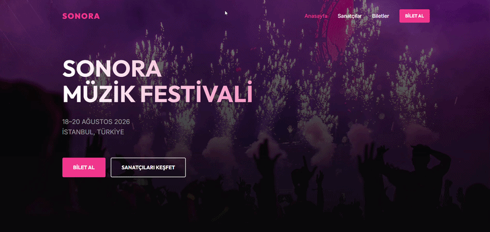

# SONORA Music Festival 2026

A modern, responsive music festival website built with **HTML5, SCSS, and CSS3**. SONORA provides visitors with an overview of the festival, featured artists, ticket packages, and frequently asked questions.

## Features

- **Homepage:** Hero section, featured artists, festival introduction, and call-to-action.
- **Artists Page:** Artist cards featuring names, music genres, and stage information.
- **Tickets Page:** Early Bird, General Admission, and VIP ticket packages.
- **FAQ Section:** Expandable questions built with native HTML `
` and `
` elements.
- **Responsive Layout:** CSS Grid, Flexbox, and media queries for different screen sizes.
- **SCSS Architecture:** Organized stylesheets using variables, mixins, and modular files.
- **Reusable Components:** Shared styles for buttons, containers, navigation, artist cards, and footer.
- **Modern Visual Design:** Dark background, gradient accents, hover effects, and custom typography.

 ---
 
## Technologies Used

- HTML5
- CSS3
- SCSS / Sass
- CSS Grid
- Flexbox
- Media Queries
- Google Fonts — Inter and Outfit
- Pexels — festival and concert images

---

# İmages

1. https://images.pexels.com/photos/1190298/pexels-photo-1190298.jpeg
2. https://images.pexels.com/photos/1763075/pexels-photo-1763075.jpeg
3. https://images.pexels.com/photos/2111015/pexels-photo-2111015.jpeg
4. https://images.pexels.com/photos/2263436/pexels-photo-2263436.jpeg
5. https://images.pexels.com/photos/1105666/pexels-photo-1105666.jpeg
6. https://images.pexels.com/photos/144428/pexels-photo-144428.jpeg

---

## 🔍 Preview

---

## 📞 Contact  

📩 **Email:** [saadetnajaf@gmail.com](mailto:saadetnajaf@gmail.com)  
📷 **Instagram:** [@saadet_najaf](https://www.instagram.com/saadet_najaf)  
💼 **LinkedIn:** [Saadet Najaf](https://www.linkedin.com/in/saadetnajaf/)
